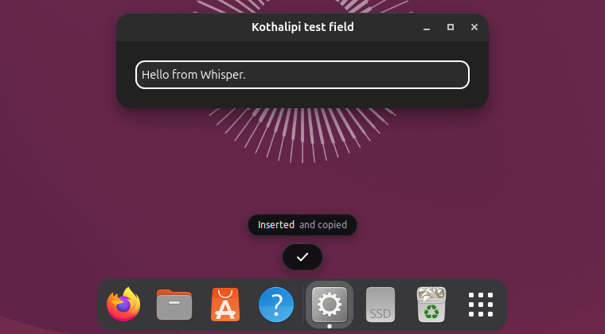
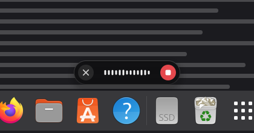
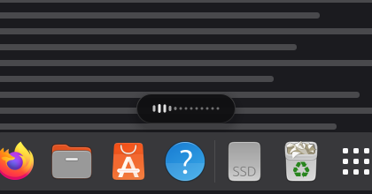
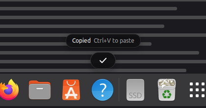

<p align="center"></p>

<h1 align="center">Kothalipi</h1>

<p align="center">
  Dictation for GNOME Shell. Speak, and your words appear where you are typing.<br>
  Speech recognition runs on your own machine with <a href="https://github.com/openai/whisper">Whisper</a>.
</p>

<p align="center">
  <a href="./LICENSE"></a>
  
  <a href="https://github.com/mohiuddin200/kothalipi/actions/workflows/ci.yml"></a>
</p>



**Kothalipi** (কথালিপি) is Bengali for "speech-writing".

> **Status:** early. Kothalipi is not yet on extensions.gnome.org and its service is not yet on PyPI.
> For now, install from source as described below.

Kothalipi is a fork of [Speech2Text](https://github.com/kavehtehrani/speech2text-extension) by Kaveh Tehrani, with a
redesigned interface. See [Credits](#credits).

## Features

- **Dictate anywhere.** Press a shortcut, click the pill at the bottom of the screen, or click the top-bar icon.
- **Text goes to your cursor.** Kothalipi hands the text to the focused field directly. If the app does not accept
  that, it pastes instead; if nothing is focused, the text is left on the clipboard.
- **Words while you speak.** An optional rough preview appears above the pill during recording.
- **Private by design.** Audio is recorded and transcribed locally. Nothing is sent to a server.
- **Many languages.** Whatever your chosen Whisper model supports.
- **CPU or GPU.** Runs on CPU by default; NVIDIA CUDA is supported for larger models.

## How it looks

| Recording | Transcribing |
| --- | --- |
|  |  |
| **Done** | **Something went wrong** |
|  |  |

The pill follows your light or dark desktop, and the top bar gets a small icon:

| Light desktop | Top-bar icon |
| --- | --- |
|  |  |

These images come from the project's screenshot harness (`make shots`), which runs the extension in a test shell.

## How it works

Kothalipi has two parts:

1. **The GNOME Shell extension** (`src/`): the pill, the top-bar icon, the shortcut and the settings.
2. **A background service** (`service/`): records audio with FFmpeg and transcribes it with Whisper.

They talk over D-Bus (`io.github.mohiuddin200.Kothalipi`). The service is installed separately, into its own Python
virtual environment, because GNOME extensions are not allowed to bundle that kind of code.

## Requirements

- GNOME Shell 46 to 50
- Python 3.8 to 3.13, with the `venv` module
- FFmpeg
- A clipboard tool: `wl-clipboard` on Wayland, `xclip` or `xsel` on X11
- `xdotool` on X11 only

On Ubuntu or Debian:

```bash
sudo apt install ffmpeg python3-venv wl-clipboard
```

The service installer checks these and tells you what is missing.

## Installation

### 1. Install the extension

```bash
git clone https://github.com/mohiuddin200/kothalipi.git
cd kothalipi
make install
```

`make install` links `src/` into `~/.local/share/gnome-shell/extensions/`, so keep the clone where it is.

### 2. Install the service

```bash
./service/install-service.sh --local --whisper-model base
```

This creates `~/.local/share/kothalipi-service` and downloads the speech recognition libraries, which takes a few
minutes. The `base` model on CPU is a good starting point.

To use an NVIDIA GPU and a larger model:

```bash
./service/install-service.sh --local --gpu --whisper-model small
```

Models are `tiny`, `base`, `small`, `medium`, `large` and their variants; see the
[Whisper documentation](https://github.com/openai/whisper#available-models-and-languages). Re-run the installer to
switch between CPU and GPU. More detail is in the [service README](./service/README.md).

### 3. Restart GNOME Shell and enable

- **Wayland:** log out and log back in.
- **X11:** press `Alt+F2`, type `r`, press `Enter`.

Then:

```bash
gnome-extensions enable kothalipi@mohiuddin200.github.io
```

## Usage

1. Put your cursor where you want the text.
2. Press **Super+Alt+R**, or click the pill or the top-bar icon.
3. Speak.
4. Press the shortcut again, or click the red stop button. Click **×** to cancel.

The text is inserted at your cursor. Recording also stops on its own when it reaches the recording limit (60 seconds
by default).

Right-click the top-bar icon for **Settings** and **Setup**.

### Settings

| Setting | What it does |
| --- | --- |
| Dictation shortcut | Press it anywhere to start or stop dictating. |
| Recording limit | Dictation stops on its own after this long. |
| Show words while you speak | A rough preview above the pill. It is not the final text. |
| Insert text at the cursor | When no field is focused, the text is copied instead. |
| Copy to clipboard | Also keep each transcript on the clipboard. |
| Show the pill when idle | A small pill at the bottom of the screen. Click it to dictate. |

## Troubleshooting

**The extension does not appear.** Make sure you restarted GNOME Shell after installing, then check:

```bash
make status
gnome-extensions info kothalipi@mohiuddin200.github.io
```

**Recording does not start, or the Setup dialog keeps appearing.** Check that the service answers:

```bash
gdbus call --session --dest io.github.mohiuddin200.Kothalipi \
  --object-path /io/github/mohiuddin200/Kothalipi \
  --method io.github.mohiuddin200.Kothalipi.GetServiceStatus
```

If it does not, run it by hand to see the error:

```bash
~/.local/share/kothalipi-service/kothalipi-service
```

**Logs:**

```bash
journalctl -f | grep -iE "kothalipi|whisper|ffmpeg"
```

**GNOME Shell crashed.** Run `./debug-crash.sh` afterwards and attach its report to your issue.

## Uninstalling

```bash
gnome-extensions disable kothalipi@mohiuddin200.github.io
make clean   # removes the extension link and the service
```

## Contributing

Bug reports, ideas and pull requests are welcome. Start with [CONTRIBUTING.md](./CONTRIBUTING.md); it explains how to
run the extension in a test shell without touching your real session. Please also read the
[Code of Conduct](./CODE_OF_CONDUCT.md). To report a security problem, see [SECURITY.md](./SECURITY.md).

## Credits

Kothalipi is a fork of [Speech2Text](https://github.com/kavehtehrani/speech2text-extension) by
[Kaveh Tehrani](https://github.com/kavehtehrani) and its contributors. The background service, the D-Bus design and
the installer come from that project. Thank you.

Speech recognition is done by [OpenAI Whisper](https://github.com/openai/whisper).

## License

[GPL-3.0-or-later](./LICENSE), the same license as the project it is forked from.
