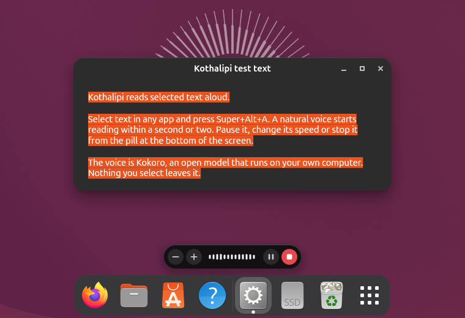
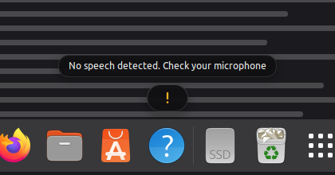
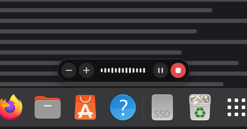
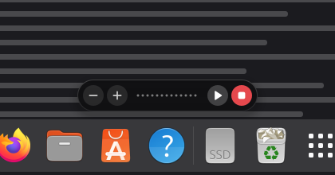
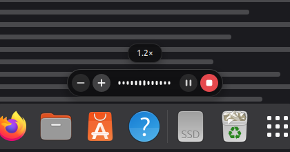
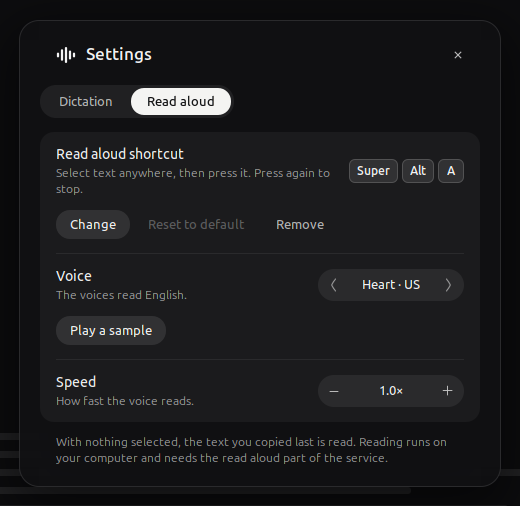
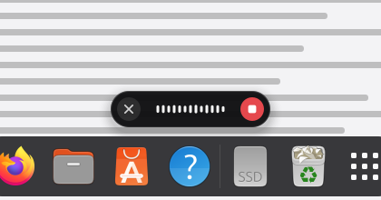

<p align="center"></p>

<h1 align="center">Kothalipi</h1>

<p align="center">
  Dictation and read aloud for GNOME Shell.<br>
  Speak, and your words appear where you are typing. Select text, and a voice reads it to you.<br>
  Both run on your own machine: <a href="https://github.com/openai/whisper">Whisper</a> listens and
  <a href="https://github.com/hexgrad/kokoro">Kokoro</a> speaks.
</p>

<p align="center">
  <a href="./LICENSE"></a>
  
  <a href="https://github.com/mohiuddin200/kothalipi/actions/workflows/ci.yml"></a>
</p>




**Kothalipi** (কথালিপি) is Bengali for "speech-writing".

> **Status:** early. Kothalipi is not yet on extensions.gnome.org and its service is not yet on PyPI.
> For now, install from source as described below.

Kothalipi is a fork of [Speech2Text](https://github.com/kavehtehrani/speech2text-extension) by Kaveh Tehrani, with a
redesigned interface. See [Credits](#credits).

## Features

- **Dictate anywhere.** Press a shortcut, click the pill at the bottom of the screen, or click the top-bar icon.
- **Text goes to your cursor.** Kothalipi hands the text to the focused field directly. If the app does not accept
  that, it pastes instead; if nothing is focused, the text is left on the clipboard.
- **Words while you speak.** An optional rough preview appears above the pill during recording.
- **Read aloud.** Select text in any app, press a shortcut, and a natural voice reads it to you. Pause it, make it
  faster or slower, or stop it from the pill. Optional; see [Read aloud](#read-aloud).
- **Private by design.** Audio is recorded and transcribed locally, and text is read locally. Nothing is sent to a
  server.
- **Many languages.** Whatever your chosen Whisper model supports.
- **CPU or GPU.** Runs on CPU by default; NVIDIA CUDA is supported for larger models.

## How it looks

| Recording | Transcribing |
| --- | --- |
|  |  |
| **Done** | **Something went wrong** |
|  |  |

Reading aloud uses the same pill, with buttons for slower, faster, pause and stop:

| Reading | Paused |
| --- | --- |
|  |  |
| **Changing the speed** | **Read aloud settings** |
|  |  |

The pill follows your light or dark desktop, and the top bar gets a small icon:

| Light desktop | Top-bar icon |
| --- | --- |
|  |  |

These images come from the project's screenshot harness (`make shots`), which runs the extension in a test shell.

## How it works

Kothalipi has two parts:

1. **The GNOME Shell extension** (`src/`): the pill, the top-bar icon, the shortcut and the settings.
2. **A background service** (`service/`): records audio with FFmpeg and transcribes it with Whisper. With read
   aloud installed, it also turns text into speech with the Kokoro-82M model and plays it.

They talk over D-Bus (`io.github.mohiuddin200.Kothalipi`). The service is installed separately, into its own Python
virtual environment, because GNOME extensions are not allowed to bundle that kind of code.

## Requirements

- GNOME Shell 46 to 50
- Python 3.8 to 3.13, with the `venv` module
- FFmpeg
- A clipboard tool: `wl-clipboard` on Wayland, `xclip` or `xsel` on X11
- `xdotool` on X11 only
- For read aloud (optional): Python 3.10 to 3.13, and `paplay` or `pw-play`, which most desktops already have

On Ubuntu or Debian:

```bash
sudo apt install ffmpeg python3-venv wl-clipboard
```

The service installer checks these and tells you what is missing.

## Installation

### Quick setup with an AI agent

If you use a coding agent such as Claude Code, copy this prompt into it. It checks your hardware, picks a suitable
Whisper model, adds read aloud when your computer can run it, and does the setup for you. To install by hand instead,
follow the three steps below.

```text
Set up the Kothalipi extension for GNOME Shell on this computer. It does two things, both on this
computer with nothing sent to a server: dictation (speech to text with Whisper) and read aloud
(text to speech with Kokoro).
Source and instructions: https://github.com/mohiuddin200/kothalipi (read the README first).

1. Check that this is Linux running GNOME Shell 46 to 50 (gnome-shell --version) and note whether the
   session is Wayland or X11 (echo $XDG_SESSION_TYPE). If it is not GNOME, stop and tell me.
2. Check my hardware: CPU threads (nproc), memory (free -g), free disk space in my home folder
   (df -h ~), and whether there is an NVIDIA GPU with working drivers and how much memory it has
   (nvidia-smi --query-gpu=name,memory.total --format=csv,noheader).
3. Choose the Whisper model and device for dictation from what you found:
   - NVIDIA GPU with 8 GB or more of GPU memory, and 10 GB free disk: --gpu --whisper-model medium
   - NVIDIA GPU with 4 to 8 GB of GPU memory, and 10 GB free disk:    --gpu --whisper-model small
   - No usable NVIDIA GPU (or less than 4 GB, or not enough disk), running on CPU:
       12 or more CPU threads and 16 GB or more memory:  --whisper-model small
       4 or more CPU threads and 8 GB or more memory:    --whisper-model base
       anything less:                                    --whisper-model tiny
   CPU mode needs about 4 GB of free disk. If there is less, stop and tell me.
4. Decide whether to add read aloud. It uses the Kokoro-82M voice model, which runs on the CPU
   whatever you chose in step 3. Add --read-aloud to the options unless one of these is missing:
   - Python 3.10 to 3.13 (dictation alone also works on 3.8 and 3.9)
   - about 400 MB of free disk on top of what step 3 needs
   - about 1.5 GB of memory to spare, on top of what the Whisper model uses
   - an audio player: paplay or pw-play
   Tell me in three lines what hardware you found, which Whisper model you chose and why, and
   whether read aloud is included (and if not, what was missing), then continue without waiting
   for an answer.
5. Check for git, make, ffmpeg, Python with the venv module, and a clipboard tool (wl-clipboard on
   Wayland; xclip and xdotool on X11). List anything missing and ask me before running any sudo
   command to install it.
6. Clone the repository to ~/.local/src/kothalipi (or update it with git pull if it is already there).
   It must stay there, because the extension is linked from it.
7. In the clone, run: make install
8. Install the background service with the options you chose in steps 3 and 4:
   ./service/install-service.sh --local --non-interactive <options>
   This downloads the speech recognition libraries and takes several minutes, longer in GPU mode.
   With --read-aloud it also downloads the voice model, about 350 MB.
9. Check that the service answers:
   gdbus call --session --dest io.github.mohiuddin200.Kothalipi --object-path /io/github/mohiuddin200/Kothalipi --method io.github.mohiuddin200.Kothalipi.GetServiceStatus
   The reply should start with 'ready'.
   If you installed read aloud, also check that ~/.local/share/kothalipi-service/install-state.conf
   has the line read_aloud=true, and that ~/.local/share/kothalipi-service/tts holds
   kokoro-v1.0.onnx and voices-v1.0.bin. Do not play any sound to test it without asking me first;
   I can hear the voice myself by running dev/say.sh in the clone.
10. Run: gnome-extensions enable kothalipi@mohiuddin200.github.io
    On Wayland this fails until I have logged out and back in. That is expected: do not log me out or
    restart my session. Tell me to log out, log back in, and run that command myself.
11. Finish with a short summary: my hardware, the Whisper model you installed, whether read aloud
    is installed, anything that failed, and how to use both:
    - Dictation: press Super+Alt+R, speak, press it again. The first dictation is slower because
      the Whisper model downloads.
    - Read aloud: select text in any app and press Super+Alt+A. The pill at the bottom of the
      screen has buttons for slower, faster, pause and stop. The voice and speed are in Settings,
      on the Read aloud tab.
    Mention that I can switch the Whisper model or add read aloud later by re-running the installer.

Do not change any other system settings, and do not delete anything outside ~/.local/src/kothalipi.
```

### 1. Install the extension

```bash
git clone https://github.com/mohiuddin200/kothalipi.git
cd kothalipi
make install
```

`make install` links `src/` into `~/.local/share/gnome-shell/extensions/`, so keep the clone where it is.

### 2. Install the service

```bash
./service/install-service.sh --local --whisper-model base
```

This creates `~/.local/share/kothalipi-service` and downloads the speech recognition libraries, which takes a few
minutes. The `base` model on CPU is a good starting point.

To use an NVIDIA GPU and a larger model:

```bash
./service/install-service.sh --local --gpu --whisper-model small
```

Which model to pick is a trade-off between accuracy and speed. As a starting point:

| Your computer | Suggested options |
| --- | --- |
| NVIDIA GPU, 8 GB or more of GPU memory | `--gpu --whisper-model medium` |
| NVIDIA GPU, 4 to 8 GB of GPU memory | `--gpu --whisper-model small` |
| No NVIDIA GPU, 12+ CPU threads and 16+ GB memory | `--whisper-model small` |
| No NVIDIA GPU, 4+ CPU threads and 8+ GB memory | `--whisper-model base` |
| Anything less | `--whisper-model tiny` |

GPU mode needs about 10 GB of free disk space; CPU mode about 4 GB.

To have selected text read aloud as well, add `--read-aloud` to either command:

```bash
./service/install-service.sh --local --whisper-model base --read-aloud
```

This adds the Kokoro-82M voice model and the library that runs it, about 400 MB in all. It runs on the CPU, also in
GPU mode. See [The voice model](#the-voice-model) for what gets installed.

Models are `tiny`, `base`, `small`, `medium`, `large` and their variants; see the
[Whisper documentation](https://github.com/openai/whisper#available-models-and-languages). Re-run the installer to
switch between CPU and GPU. More detail is in the [service README](./service/README.md).

### 3. Restart GNOME Shell and enable

- **Wayland:** log out and log back in.
- **X11:** press `Alt+F2`, type `r`, press `Enter`.

Then:

```bash
gnome-extensions enable kothalipi@mohiuddin200.github.io
```

## Usage

1. Put your cursor where you want the text.
2. Press **Super+Alt+R**, or click the pill or the top-bar icon.
3. Speak.
4. Press the shortcut again, or click the red stop button. Click **×** to cancel.

The text is inserted at your cursor. Recording also stops on its own when it reaches the recording limit (60 seconds
by default).

Right-click the top-bar icon for **Settings** and **Setup**.

### Read aloud

1. Select text in any app: a web page, a document, a terminal.
2. Press **Super+Alt+A**, or right-click the top-bar icon and choose **Read selected text aloud**.
3. Use the pill while it reads:

| Button | What it does |
| --- | --- |
| **−** and **+** | Make the voice slower or faster, a tenth at a time, from 0.5× to 2.0×. The new speed shows above the pill and is kept for the next reading. |
| **Pause** | Holds the reading. It turns into **Play**, which carries on from the same place. Clicking the pill itself does the same. |
| **Stop** (red) | Ends the reading. So does pressing **Super+Alt+A** again. |

Reading starts within a second or two and continues to the end of the selection. With nothing selected, the text you
copied last is read. Markdown marks are left out and a web address is read as "link", so documentation reads cleanly.
After a change of speed there is a short silence, then the voice carries on from the phrase it was reading.

Starting a dictation stops a reading, so the microphone does not record the voice.

Read aloud needs the service installed with `--read-aloud`; see [Install the service](#2-install-the-service).

#### The voice model

Read aloud uses [Kokoro-82M](https://huggingface.co/hexgrad/Kokoro-82M), an open text-to-speech model, through the
[kokoro-onnx](https://github.com/thewh1teagle/kokoro-onnx) library.

| | |
| --- | --- |
| Model | Kokoro-82M version 1.0, 82 million parameters, Apache-2.0 license |
| Runs on | The CPU, with ONNX Runtime. It does not use the GPU, so it never competes with Whisper for GPU memory. |
| Files | `kokoro-v1.0.onnx` (326 MB) and `voices-v1.0.bin` (28 MB), in `~/.local/share/kothalipi-service/tts` |
| Sound | 24 kHz mono, played through `paplay` or `pw-play` |
| Voices | 28 English voices, American and British. Settings offers 11 of them. |
| Speed | On a 4-core Intel Core i3-12100 it makes speech about 4 times faster than it is spoken. |
| Memory | About 1.2 GB once loaded. It loads on the first reading and stays loaded until the service restarts. |

The voices in Settings are Heart, Bella, Nicole, Sarah, Michael, Fenrir and Puck (American) and Emma, Isabella,
George and Fable (British). To use another English voice from the
[Kokoro voice list](https://huggingface.co/hexgrad/Kokoro-82M/blob/main/VOICES.md), set its name directly:

```bash
gsettings --schemadir ~/.local/share/gnome-shell/extensions/kothalipi@mohiuddin200.github.io/schemas \
  set org.gnome.shell.extensions.kothalipi read-aloud-voice af_nova
```

The model file also holds voices for a few other languages. Kothalipi has only been tested with the English ones, and
there is no Bangla voice.

How a reading is made: the selection is cleaned and cut into pieces at sentence ends. The first piece is one short
sentence, so the first words come quickly, and each later piece is made while the one before it plays. Pausing holds
the audio player still. A change of speed makes the rest of the text again at the new speed.

### Settings

| Setting | What it does |
| --- | --- |
| Dictation shortcut | Press it anywhere to start or stop dictating. |
| Recording limit | Dictation stops on its own after this long. |
| Language | The language you dictate in. Auto-detect can misread your first words. |
| Show words while you speak | A rough preview above the pill. It is not the final text. |
| Insert text at the cursor | When no field is focused, the text is copied instead. |
| Copy to clipboard | Also keep each transcript on the clipboard. |
| Show the pill when idle | A small pill at the bottom of the screen. Click it to dictate. |
| Read aloud shortcut | Select text anywhere, then press it. Press again to stop. |
| Voice | The voice that reads. **Play a sample** lets you hear it. |
| Speed | How fast the voice reads. The **−** and **+** buttons on the pill change the same setting. |

## Troubleshooting

**The extension does not appear.** Make sure you restarted GNOME Shell after installing, then check:

```bash
make status
gnome-extensions info kothalipi@mohiuddin200.github.io
```

**Recording does not start, or the Setup dialog keeps appearing.** Check that the service answers:

```bash
gdbus call --session --dest io.github.mohiuddin200.Kothalipi \
  --object-path /io/github/mohiuddin200/Kothalipi \
  --method io.github.mohiuddin200.Kothalipi.GetServiceStatus
```

If it does not, run it by hand to see the error:

```bash
~/.local/share/kothalipi-service/kothalipi-service
```

**The pill says "Read aloud is not installed".** Re-run the service installer with `--read-aloud` added to the
options you used before, then restart the service: `pkill -f kothalipi-service`.

**Logs:**

```bash
journalctl -f | grep -iE "kothalipi|whisper|ffmpeg"
```

**GNOME Shell crashed.** Run `./debug-crash.sh` afterwards and attach its report to your issue.

## Uninstalling

```bash
gnome-extensions disable kothalipi@mohiuddin200.github.io
make clean   # removes the extension link and the service
```

## Contributing

Bug reports, ideas and pull requests are welcome. Start with [CONTRIBUTING.md](./CONTRIBUTING.md); it explains how to
run the extension in a test shell without touching your real session. Please also read the
[Code of Conduct](./CODE_OF_CONDUCT.md). To report a security problem, see [SECURITY.md](./SECURITY.md).

## Credits

Kothalipi is a fork of [Speech2Text](https://github.com/kavehtehrani/speech2text-extension) by
[Kaveh Tehrani](https://github.com/kavehtehrani) and its contributors. The background service, the D-Bus design and
the installer come from that project. Thank you.

Speech recognition is done by [OpenAI Whisper](https://github.com/openai/whisper). Reading aloud is done by
[Kokoro](https://github.com/hexgrad/kokoro), run through [kokoro-onnx](https://github.com/thewh1teagle/kokoro-onnx).

## License

[GPL-3.0-or-later](./LICENSE), the same license as the project it is forked from.
